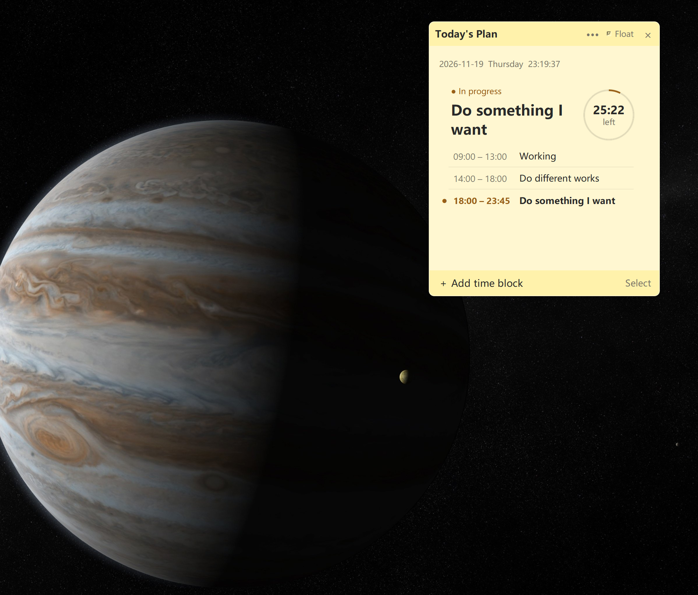
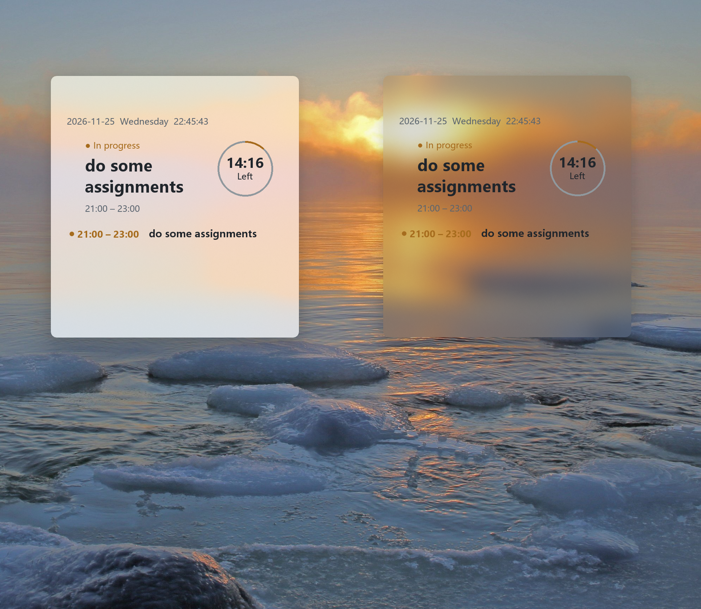
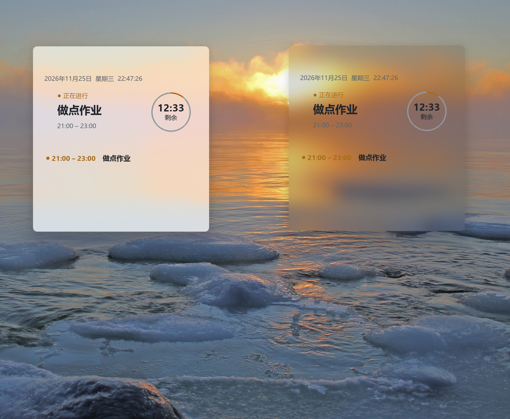

# DailyPlanner

Your plan for the day, right on your desktop.

DailyPlanner is a small Windows app that keeps your schedule in a floating sticky note. Add a few time blocks, write down what you want to do, and leave it beside your work. It shows your current task, counts down the time left, and reminds you when a block ends.

[Download the app](https://github.com/xiaonaodai/dailyplanner/releases) · [中文版](#今日计划)

## A little window that feels at home

Keep the familiar colored sticky note, or turn on frosted glass and let your wallpaper show through.

**Mica** gives the window a soft, misty look. **High transparency** brings through more of the colors behind it. Both have rounded corners, with crisp text over the blurred background.






## What you can do

- **Plan your day in time blocks.** Add a task, set its start and end time, and choose a reminder.
- **Know what to focus on.** The current task and its countdown stay in view. When the day's plan is over, a checkmark lets you know you're done.
- **Make it yours.** Pick your note and frame colors, or grab a color from anywhere on your screen.
- **Put it where you like.** Drag the window around, resize it, and use the pin checkbox to keep it above other windows.
- **Tuck it away.** Closing the panel sends it to the system tray. Click the tray icon to bring it back.
- **Choose your language.** English and Simplified Chinese are available.

## Get started

1. Head to [Releases](https://github.com/xiaonaodai/dailyplanner/releases) and download **DailyPlanner-Setup.exe**.
2. Open the installer, choose your language and installation folder, and finish the setup.
3. Open DailyPlanner from your desktop or Start menu and add your first time block.

You can use the installed app without installing Python. To quit completely, right-click its icon in the system tray and choose Quit. Before installing an update, quit the old instance there first.

The planner supports 64-bit Windows 10 and later. For the rounded frosted-glass look shown above, use Windows 11 and turn on Windows transparency effects.

## What's new in 1.1.0

This release adds the rounded Mica and High transparency looks. It also improves clicking and dragging in glass mode and fixes the completion and pin checkmarks.

We took a few detours to get this glass working, including yellow backgrounds, pale text fringes, tiny click targets and rounded corners that turned the panel white. The [bilingual implementation notes](ACRYLIC.md) explain how we worked through them.

There is also a **Goof off** button. Click it when you want a little time away from work... The three-dot menu at the top right opens your daily report, where you can see how much time you spent working, goofing off and resting. You can also choose when the daily report reminder appears.

For developers looking into **Python Tkinter acrylic, Windows desktop blur and transparent windows**, the implementation notes cover the C# backdrop host, alpha-composited text, mouse hit testing and rounded corners, with links to the relevant source files.

## Build it yourself

You'll need 64-bit Windows, Python 3.12 or later, a .NET SDK with .NET Framework 4.7.2 targeting support, and Inno Setup 6. The first build needs an internet connection to download dependencies.

Open PowerShell in the project folder and run the following commands. Adjust the last path if you installed Inno Setup somewhere else.

```powershell
python -m pip install pyinstaller pystray pillow
.\package_app.ps1
& "$env:LOCALAPPDATA\Programs\Inno Setup 6\ISCC.exe" .\DailyPlanner.iss
```

The installer will be at `release\DailyPlanner-Setup.exe`. You can also run `release\DailyPlanner\DailyPlanner.exe` directly, keeping the whole DailyPlanner folder together.

To run from source, install `pystray` and `pillow`, build the glass helper following [ACRYLIC.md](ACRYLIC.md), and open `timer_note.pyw`.

## Your data

Your schedule, settings and statistics stay on your computer in `%APPDATA%\DailyPlanner`. Uninstalling the app keeps this folder so your plans are still there if you reinstall.

The JSON files included in the repository are starter defaults. If you contribute changes, check that your personal schedule and settings aren't included.

## License

DailyPlanner is available under the [MIT License](LICENSE).

---

# 今日计划

把今天要做的事，放在桌面上。

今日计划是一款 Windows 桌面小工具，像一张贴在桌面上的便签。填好几个时间段，写下要做的事，把它放在工作窗口旁边，就能随时看到现在该做什么、还剩多少时间。一个时间段结束时，它会提醒你。

[下载安装](https://github.com/xiaonaodai/dailyplanner/releases) · [English](#dailyplanner)





## 给桌面添一块毛玻璃

你可以用熟悉的彩色便签，也可以打开亚克力，让壁纸的颜色透进来。

喜欢柔和一点的感觉，就选**云母**，像隔着一层薄雾。喜欢更通透的感觉，就选**高透**，窗后的颜色会更明显。两种都有圆角，背景模糊，文字清楚。

效果可以看上面的截图，左右对比图里左侧是云母，右侧是高透。

## 它能帮你做什么

- **把一天安排成几个时间段。** 写任务、设开始和结束时间，再加一句结束提醒。
- **随时看见眼前的事。** 当前任务和倒计时会显示在面板上。当天的计划结束后，会出现一个完成的对勾。
- **调成自己喜欢的颜色。** 纸面和边框都能改色，还能直接从屏幕上吸取喜欢的颜色。
- **放在顺手的位置。** 窗口可以拖动、调整大小，勾上“悬浮”就能一直显示在其他窗口上面。
- **暂时收起来。** 点关闭后，它会藏到右下角托盘。需要时点一下托盘图标，就回来了。
- **切换中英文。** 可以按自己的习惯选择界面语言。

## 下载后怎么用

1. 打开 [Releases 下载页](https://github.com/xiaonaodai/dailyplanner/releases)，下载 **DailyPlanner-Setup.exe**。
2. 双击安装包，选好语言和安装位置，跟着提示安装。
3. 从桌面快捷方式或开始菜单打开，添加第一个时间段。

安装版下载后就能用，无需安装 Python。如果想彻底退出，右键点击右下角托盘里的图标，再选择退出。更新版本前，也先从这里退出旧程序。

普通计划功能支持 64 位 Windows 10 及以上系统。想用上图里的圆角毛玻璃效果，请使用 Windows 11，并在系统设置中打开“透明效果”。

## 1.1.0 更新了什么

这次加入了圆角云母和高透两种外观，也修好了毛玻璃模式下的点击、拖动，以及完成状态和悬浮按钮的对勾。

为了做出这块毛玻璃，我们确实走了不少弯路。黄底、文字白边、只能点到字、圆角一开就变白，都碰到过。感兴趣的话，可以看看[中英双语技术记录](ACRYLIC.md)，里面写了这些问题是怎么一步步解决的。

还新增了摸鱼功能，点击摸鱼就可以去放心摸鱼了...你在右上角三个点里能看到自己的统计日报，还可以设置每日推送统计日报的时间，在那里你能看到每天摸了多少鱼，认真干活多久，休息多久。

如果你在研究 **Python Tkinter 亚克力、Windows 桌面背景模糊或透明窗口**，技术记录里还写了 C# 背景程序、文字透明合成、鼠标点击区域和圆角的实现，并附有对应源码入口。
## 想自己打包

需要准备 64 位 Windows、Python 3.12 或更高版本、.NET SDK、.NET Framework 4.7.2 目标支持，以及 Inno Setup 6。第一次构建时需要联网下载依赖。

在项目文件夹里打开 PowerShell，依次运行下面的命令。如果 Inno Setup 装在其他位置，把最后一行的路径换成自己的安装位置。

```powershell
python -m pip install pyinstaller pystray pillow
.\package_app.ps1
& "$env:LOCALAPPDATA\Programs\Inno Setup 6\ISCC.exe" .\DailyPlanner.iss
```

生成的安装包在 `release\DailyPlanner-Setup.exe`。也可以直接运行 `release\DailyPlanner\DailyPlanner.exe`，使用时请保留整个 DailyPlanner 文件夹。

想直接运行源码，先安装 `pystray` 和 `pillow`，按[技术记录](ACRYLIC.md)构建毛玻璃背景程序，再打开 `timer_note.pyw`。

## 我的计划存在哪里

日程、设置和统计都保存在你自己的电脑上，位置是 `%APPDATA%\DailyPlanner`。卸载时会保留这个文件夹，以后重新安装还可以接着用。

仓库里的 JSON 文件是初始示例。如果你要提交代码，记得检查一下，避免把自己的日程和设置一起传上去。

## 许可证

本项目使用 [MIT 许可证](LICENSE)。
