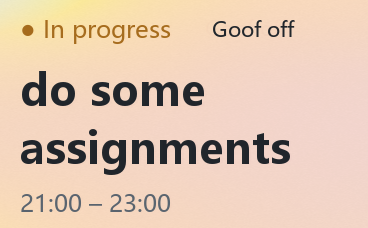

# DailyPlanner

> **Reclaim your focus. A minimalist, frosted-glass desktop companion built for personal study, time-blocking, and distraction-free deep work.**
> 
> **把时间还给自己。专为个人自习与深度专注打造的 Windows 桌面时间块毛玻璃便签。**

[Download the app (Releases)](https://github.com/xiaonaodai/dailyplanner/releases) · [Screenshots](#a-tranquil-glass-note-on-your-desktop) · [中文说明](#今日计划-dailyplanner)

---

## Why DailyPlanner?

Most productivity apps miss the reality of personal study and focused work:

- **Todo lists hoard guilt, not action.** Listing twenty items doesn't tell you *when* to do them. Tasks pile up until looking at the checklist brings anxiety rather than momentum.
- **Phone timers invite distractions.** You glance at your phone to check how much time is left on a Pomodoro cycle, see a badge, and lose twenty minutes to social media feeds.
- **It is easy to lose your sense of time.** Working on a laptop or PC often means losing yourself in dozens of browser tabs and windows, with hours slipping by unnoticed.

**DailyPlanner is built as a personal anchor for your study desk.** It is designed for students, exam preparation (such as grad school and certifications), solo makers, and personal projects.

You divide your day into a few realistic **time blocks** (e.g. `09:00 – 10:30 Practice Calculus`). DailyPlanner sits beside your open books or study windows as an ambient frosted-glass sticky note. Glance over, and you immediately know what you should be doing right now and how many minutes remain.

---

## A tranquil glass note on your desktop

DailyPlanner blends into your personal wallpaper with native Windows 11 rounded frosted glass, keeping your text pin-sharp over a soft blurred backdrop.


### Presets tailored for your setup

- **Mica (云母)**: A gentle, misty look that feels grounded and easy on the eyes during long evening study sessions.
- **High transparency (高透)**: A crystal-clear frosted glass that lets the vivid colors of your favorite anime or scenery wallpaper shine through.
- **Classic Paper**: Love the traditional sticky note look? Switch back anytime and pick custom note or frame colors using the built-in eyedropper.


---

## Features designed for real life

### 1. Time-blocking that actually works
Instead of overwhelming checklists, plan your hours in structured blocks. Each block has a start time, an end time, and an optional transition prompt to help you switch smoothly into the next task.

### 2. An ambient countdown ring
A circular progress ring quietly glides along with the clock, providing a calm visual sense of time passing without intrusive ticking.

### 3. "Goof off" button — guilt-free breaks
Real study involves mental fatigue. Forcing unbroken discipline leads to burnout. Whenever you need to step away, daydream, or scroll a video, click the **Goof off** button right next to the active task. DailyPlanner pauses without judging you.



### 4. Daily reflection report
At the end of your day (customizable, default 21:00), a gentle notification invites you to review your stats: how many hours you spent studying, taking breaks, and goofing off. Seeing your real time recorded helps you close your laptop with peace of mind.

### 5. Private, lightweight, and local-first
- **Always on top**: Pin the note to stay above your reference materials or study browser.
- **System tray friendly**: Close the window to tuck it away into the system tray; click anytime to restore it.
- **Zero cloud tracking**: 100% of your schedule and stats stay strictly on your local PC in `%APPDATA%\DailyPlanner`.

---

## Get started

1. Go to [Releases](https://github.com/xiaonaodai/dailyplanner/releases) and download **DailyPlanner-Setup.exe**.
2. Run the installer, select your preferred language (English or Simplified Chinese) and target folder.
3. Open DailyPlanner from your desktop shortcut or Start menu, add your first time block, and start your day!

*No Python installation required for the setup package. Supports 64-bit Windows 10 and 11 (Windows 11 with transparency effects enabled is recommended for rounded frosted glass).*

---

## What's new in v1.1.0

- **Rounded Mica & High-transparency glass**: True multi-layer frosted glass combining native C# DWM backdrop hosting, premultiplied alpha text composition, and full mouse hit-testing.
- **Goof-off mode & Daily Report**: Track active work, rest, and leisure time with custom evening report push notifications.
- **Refined interaction**: Fixed edge clicking, smooth dragging across monitors, and improved checkmark indicators.

For developers interested in **Python Tkinter acrylic windows, custom WinForms backdrop hosts, and DWM composition**, see our detailed [implementation notes (ACRYLIC.md)](ACRYLIC.md).

---

## Build from source (For Developers)

> [!NOTE]
> **For everyday users:** You do **not** need to install Python or build anything! Simply grab `DailyPlanner-Setup.exe` from [Releases](https://github.com/xiaonaodai/dailyplanner/releases) to use the app directly.
> 
> This section is for developers and makers who want to modify the source code, tweak features, or compile the project themselves.

Requirements: Windows 64-bit, Python 3.12+, .NET SDK (.NET Framework 4.7.2 targeting support), and Inno Setup 6.

```powershell
python -m pip install pyinstaller pystray pillow
.\package_app.ps1
& "$env:LOCALAPPDATA\Programs\Inno Setup 6\ISCC.exe" .\DailyPlanner.iss
```

The installer will be generated at `release\DailyPlanner-Setup.exe`.

---

## License

Released under the [MIT License](LICENSE).

---

# 今日计划 (DailyPlanner)

> **把时间还给自己。专为个人自习、备考与深度专注打造的 Windows 桌面时间块毛玻璃便签。**

[下载安装包 (Releases)](https://github.com/xiaonaodai/dailyplanner/releases) · [界面截图](#给桌面添一块静心的毛玻璃) · [English](#dailyplanner)

---

## 为什么做这款小工具？

市面上绝大多数待办工具，往往让人越用越累：

- **待办清单只囤积焦虑，解决不了拖延。** 任务列了一长串，打勾虽然爽，却从不告诉你“什么时候做”。最后清单越积越厚，甚至让人不敢打开。
- **手机番茄钟是隐形的注意力杀手。** 拿起手机只是想看一眼倒计时，锁屏通知一亮，顺手就刷了半小时社交媒体或视频。
- **面对电脑自习或做事，容易丧失时间感知。** 查资料时浏览器标签页开了一堆，窗口切来切去，一眨眼一个下午就没了，却想不起自己到底干了什么。

**《今日计划》是专为你自己的自习桌面打造的“时间锚点”。** 它不是用来应付团队汇报或打卡的，而是属于你个人备考（考研、考公、期末）、自习刷题、个人创作时的专注伴侣。

你只需要把今天划分成几个**实在的时间块**（比如 `09:00 – 10:30 搞懂高等数学第四章`）。它像一张半透明的毛玻璃便签，安静地悬浮在屏幕一角。抬头瞥一眼，就能看清**现在该干嘛、还剩多少分钟**。

---

## 给桌面添一块静心的毛玻璃

它支持 Windows 11 原生圆角毛玻璃效果，文字清晰锐利，透出你精心挑选的电脑壁纸。


### 两种精心打磨的通透质感

- **云母（Mica）**：像晨雾一般柔和内敛，长时间自习或晚上码字不刺眼、不喧宾夺主。
- **高透（High Transparency）**：通透晶莹，把好看的二次元壁纸或风景大图衬得层次分明。
- **经典纸张**：也保留了最纯粹的黄色便签风格。配合自带的屏幕吸色笔，可以抓取屏幕上任意颜色做专属主题。


---

## 贴合真实生活的功能细节

### 1. 时间块规划（Time-blocking）
拒绝无限堆积清单。填好开始时间、结束时间和任务内容，到期自动提醒，并提示下一项准备做什么，平滑过渡不迷茫。

### 2. 呼吸感环形倒计时
中央圆环伴随当前时间静静推进，带来一种温和的紧迫感与节奏感，不再需要神经紧绷地看秒表跳动。

### 3. “摸鱼”按钮 —— 允许自己喘口气
真正的专注不是当苦行僧。学累了、脑子卡住了想刷会视频放空？点击当前任务旁的**【摸鱼】**按钮，计时器自动切入摸鱼状态，不唠叨、不惩罚，接纳自己的真实状态。


### 4. 晚间日报反馈
每天晚上（默认 21:00，可自定义），右下角会弹出一张专属日报卡片：今天认真专注了多久、休息了多久、摸了多久鱼。看得见的付出，让你睡前心里有底气、踏实不慌张。

### 5. 纯本地、轻量私密
- **置顶悬浮**：勾选“悬浮”就能常驻在参考资料或题库窗口上方，随意拖拽移动、拉伸窗口大小。
- **托盘小憩**：点关闭后静默最小化到右下角通知区域，不占任务栏，点击托盘图标一键唤回。
- **100% 本地存储**：所有计划和统计数据都在本机 `%APPDATA%\DailyPlanner`，无需注册，绝无云端上传，你的作息完全私密。

---

## 下载与使用

1. 打开 [Releases 下载页](https://github.com/xiaonaodai/dailyplanner/releases)，下载 **DailyPlanner-Setup.exe**。
2. 双击安装包，根据提示选择语言与安装路径。
3. 从桌面图标启动，写下你的第一个专注时间块！

*安装包开箱即用，无需配置 Python 环境。支持 64 位 Windows 10 与 11（推荐 Windows 11 并开启系统“透明效果”体验圆角毛玻璃）。*

---

## 1.1.0 更新日志

- **圆角云母与高透双模式**：采用 C# 原生背景宿主 + Python 像素级透明合成 + 独立鼠标点击穿透分层架构，解决了白边、只能点到字、圆角泛白等一系列难题。
- **摸鱼模式与每日统计推送**：支持随时随地“摸鱼打卡”，晚上按时推送日报卡片。
- **底层交互升级**：修复了多显示器拖拽对齐、任务项边缘手势点击及各类中英文界面细节。

对 **Python Tkinter 亚克力毛玻璃、透明窗口合成与 Windows DWM 机制** 感兴趣的朋友，欢迎阅读我们总结的[中英双语踩坑与技术实现文档 (ACRYLIC.md)](ACRYLIC.md)。

---

## 本地编译与二次开发（开发者选项）

> [!NOTE]
> **日常使用请直接跳过这一节**：如果你只是想使用这款软件，直接在 [Releases 下载页](https://github.com/xiaonaodai/dailyplanner/releases) 下载 `DailyPlanner-Setup.exe` 即可开箱即用，电脑上**完全不需要**安装 Python 或任何开发工具！
> 
> 本节内容是专门写给想要**查看源码、修改功能或自己动手编译打包**的朋友看的。

编译环境要求：64 位 Windows、Python 3.12+、.NET SDK (.NET Framework 4.7.2 目标包支持) 与 Inno Setup 6。

```powershell
python -m pip install pyinstaller pystray pillow
.\package_app.ps1
& "$env:LOCALAPPDATA\Programs\Inno Setup 6\ISCC.exe" .\DailyPlanner.iss
```

生成的安装程序保存在 `release\DailyPlanner-Setup.exe`。

---

## 开源协议

本项目采用 [MIT 许可证](LICENSE)。
